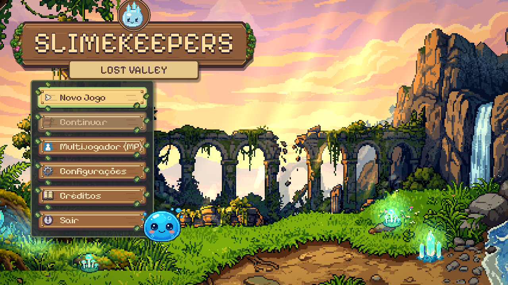

# Menu principal — vale de ruínas (2026-11-23)

Cena: `scenes/start_menu.tscn` (script `scripts/menu/start_menu.gd`).
Cenário: `scripts/menu/ruins_backdrop.gd`, tela lógica de 480×270 em escala inteira.

## Camadas (PixelLab, `assets/menu/ruins/`)

| Camada | Arquivo | Animação |
|---|---|---|
| Céu com arcos distantes | `sky.png` | nuvens soltas (`cloud.png`) atravessando |
| Ruínas, aqueduto e cachoeira | `ruins.png` | água corre (`water_flow.gdshader`), névoa na base (partículas), parallax |
| Chão, caminho natural e rio | `ground.png` | água do rio (`water_flow.gdshader`), parallax |
| Árvore antiga com cristais | `tree.png` | brisa na copa (`foliage_sway.gdshader`), folhas caindo, parallax |
| Cristais e cogumelos | `crystals.png`, `mushrooms.png` | halo em faixas pulsando, faíscas |
| Ícones dos botões | `icons/*.png` | — |

Vaga-lumes e o slime azul (frames da Bolhinha: respira, pisca, reage ao foco) completam a cena.

## Luz igual à do jogo

- Grade de cor do mundo (`world_grade.gdshader`) com o perfil da manhã dourada.
- Raios de sol e poças de luz no pé dos raios, desenhados como em `ambient_lights.gd`.
- Manchas de sol nítidas no gramado (`ambient_lights.dapple_image`), piscando com o vento.
- Halos em faixas (`ambient_lights.banded_light_texture`) nos cristais e cogumelos.

## Botões

Novo Jogo → seleção de Aren ou Moni → introdução → jogo.

- **Continuar**: só fica ativo com um save válido.
- **Multijogador**: abre um aviso de que o modo ainda está em desenvolvimento (decisão do usuário, 2026-11-23: será P2P pela Steam). Não há
  partida simulada.
- **Configurações**: a janela de opções de antes.
- **Créditos**: abre a janela de créditos.
- **Sair**: fecha o jogo.

Teclado, mouse e controle navegam entre os botões. "Reduzir movimento" para o cenário e o slime.

## Testes

- `tools/test_menu.gd`: 69 verificações (camadas, partículas, slime, movimento reduzido,
  navegação, avisos, Novo Jogo até a floresta).
- `tools/capture_menu.gd`: capturas em 1280×720, 1920×1080 e 960×540, além de 16 quadros
  da animação ([GIF](menu_animado.gif)).
