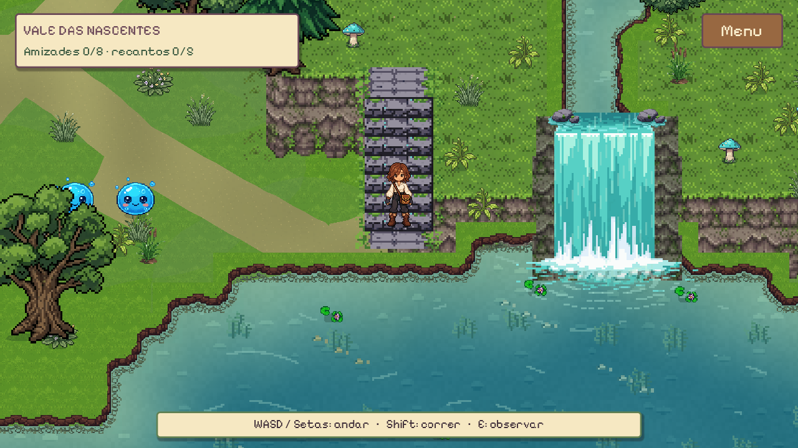
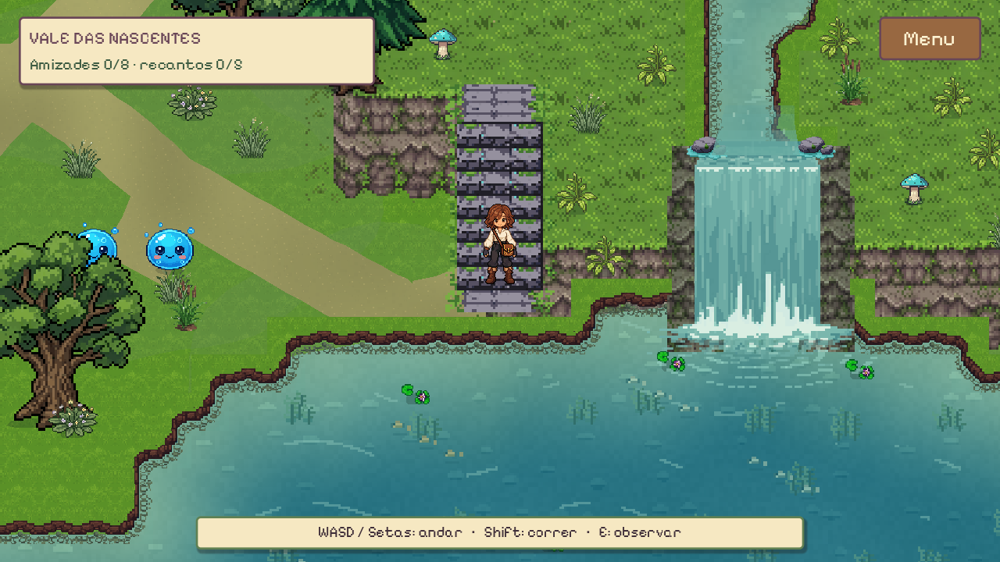
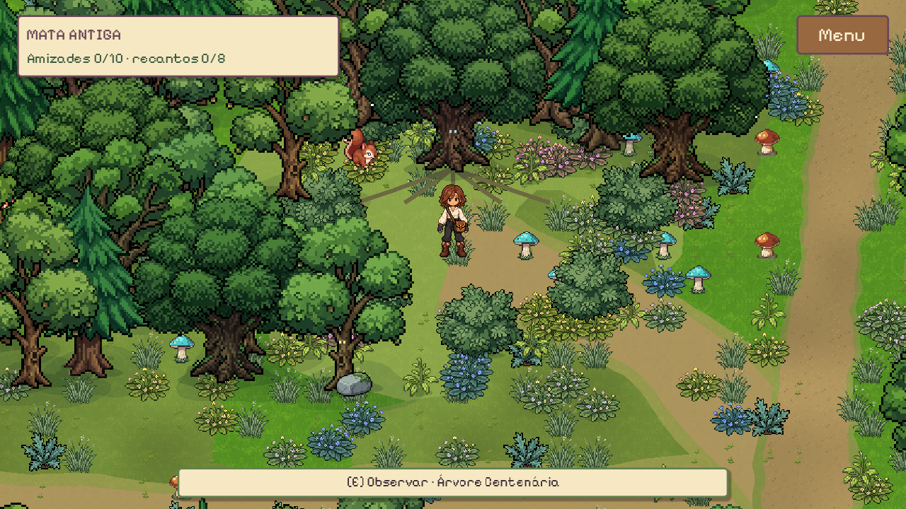
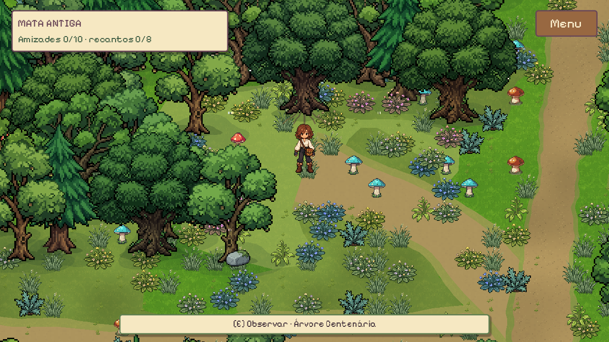
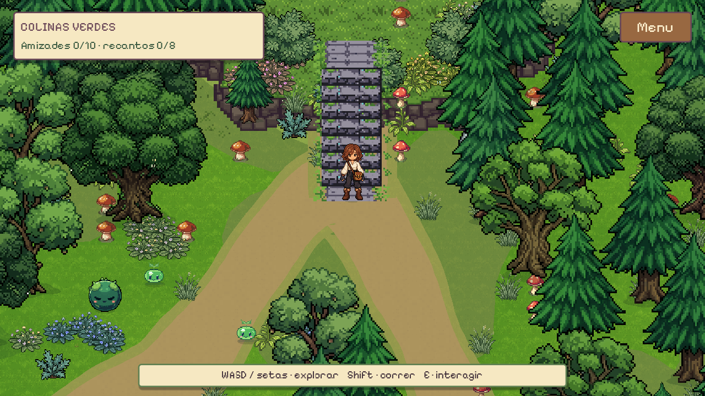
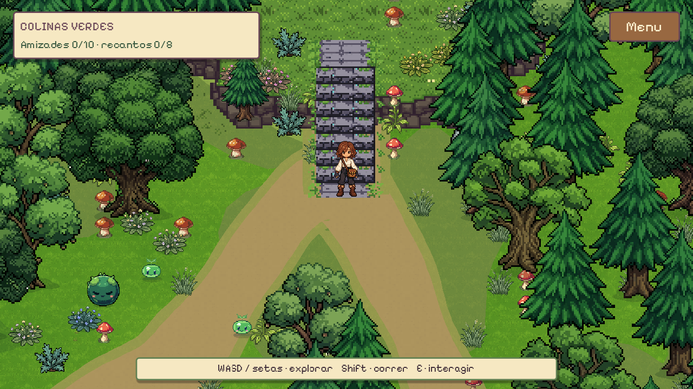
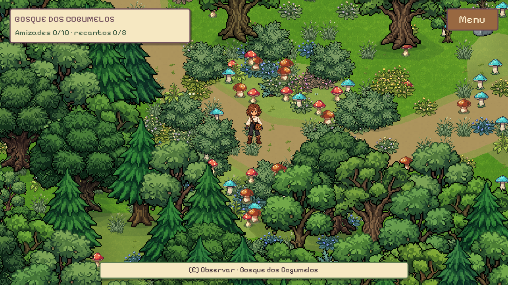
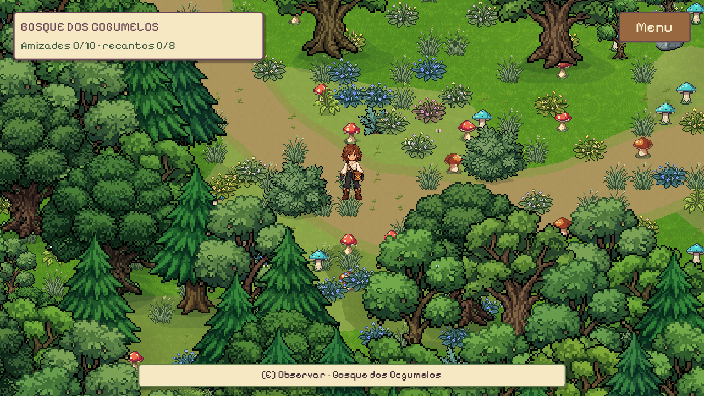

# Mundo Vivo 3.0 e correções visuais — 28/10/2026

Projeto validado em Godot 4.7.2, GL Compatibility, Radeon RX 580, janela 1280×720. A floresta de 200×200 e o Vale existente foram preservados. Movimento, tamanho do protagonista, corrida, colisões, menu, interação E e transições continuam funcionando.

## Correções entregues

`visual_rules.gd` compartilha a ordenação pelo contato com o chão entre atores, árvores, arbustos, flores, cogumelos e troncos. Os grupos têm z=0/Y-sort compatível; cada prop é uma unidade ancorada no pé. Capim e superfícies caminháveis ficam abaixo dos pés. As copas obedecem à posição Y, sem camada frontal permanente. Referência consultada pelo Parallel AI: [CanvasItem, Godot 4.7](https://docs.godotengine.org/en/stable/classes/class_canvasitem.html).

A passagem determinística tratou 5.140 props altos/médios na floresta e 1.458 no Vale, além de 80/264 elementos de chão. Foram ocultadas 808/424 plantas redundantes ou muito próximas às trilhas. Permanecem intactos 3.865/467 corpos estáticos. Não houve reconstrução dos mapas nem alteração de PNG original.

Cinco linhas diagonais eram raízes procedurais muito longas: foram reconstruídas junto à árvore. A revisão das capturas também encontrou e corrigiu uma regressão na escada das Colinas, agora coberta por teste explícito. Cachoeiras usam tons próximos do rio, espuma menos saturada e entrada com fluxo/turbulência recortados ao leito. A correção de paleta é localizada no shader das quedas.

Fauna decorativa limitada a **um indivíduo por região** (antes quatro), reposição a cada 22–38 s e afastamento inicial de 180 px dos atores. Esquilo/pássaro têm respectivamente 44,4%/36,2% da altura visual do protagonista. Água, pontes e colisores são excluídos do nascimento e movimento terrestre; voo de fuga pode passar por cima da água. Slimes não foram redimensionados.

## Mundo vivo

Vento compartilhado, reação das plantas aos atores, borboletas visitando flores, folhas, sombras ocasionais e áudio por ambiente. Simulação central a 8 Hz, buckets espaciais, atualização local e limites de efeitos. Período/clima são compartilhados entre ambiente, áudio e slimes; movimento reduzido preserva o gameplay.

Os oito Brotinhos originais permanecem, acompanhados por dois Musguinhos em habitats sombreados. O Vale possui oito Bolhinhas em seis habitats acessíveis. Bolhinha reutiliza o slime de água existente. IA por dados compartilha descanso, exploração, curiosidade, sono, preferências ambientais, brincadeiras, reação ao jogador e cooldown social. IDs estáveis preservam amizades durante viagens na sessão; E escolhe uma interação por vez.

H01 foi deslocado para (4920,3170), H03 para (3240,4870), sem redesenhar trilhas. Descoberta: rota mínima navegável de 1.815 px, primeira entrada na câmera em 9,55 s, alcance de interação em 11,73 s e chegada ao habitat em 12,42 s. Velocidade preservada em 145 px/s. Entrada na câmera não comprova percepção humana nem ausência de oclusão por copa.

## PixelLab

**16 gerações usadas das 50 autorizadas; 34 não utilizadas.** Todos os jobs concluídos antes do download. Nenhuma geração adicional foi necessária para as últimas correções.

| Recurso | Entrega |
|---|---|
| Bolhinha | 10 animações; novos clips feliz, curioso e sono; demais movimentos reaproveitados |
| Musguinho | 8 animações configuradas, incluindo idle, move, jump, happy, sleep e plant |
| Esquilo | base, andar e procurar alimento |
| Pássaro | base, saltitar e voar |

Quatro SpriteFrames, 24 animações e 191 referências a texturas. Padding de Bolhinha reconciliado com AtlasTexture, sem editar PNGs. Prompts, IDs, custos e proveniência: [PIXELLAB.md](PIXELLAB.md), [pixellab_jobs.json](pixellab_jobs.json) e manifests dos assets. Exports completos permanecem localmente em `source/`; o PR inclui runtime e metadados, sem ZIPs redundantes.

## Validação repetida a pedido do usuário

- `tools/validate_forest.ps1`: **6.174 verificações, zero falhas**, mais **7 casos GdUnit4 aprovados**. [Log da repetição](retest_validation.log).
- `test_native_depth.gd`: **8 testes de oclusão aprovados**, árvore/arbusto/cogumelo/tronco, ator atrás e à frente. Compara pixels renderizados com as camadas isoladas, separadamente da navegação no mapa.
- `test_native_bridges.gd`: **5 pontes cruzadas** com Input/controlador original. Posicionamento inicial feito separadamente em cada ponte; não é exploração contínua do Vale.
- Vento e áudio nativos: **22 + 22 verificações aprovadas**, sem erros de shader.
- Navegação física: 2.317 amostras na floresta, 2.096 no Vale e regressão de 1.972 amostras da clareira; saídas, margens, habitats e viagens exercitados.
- Fauna: 384 amostras de chão seguro nas duas regiões; população, fuga, descarte e retorno testados.
- **183 PNGs e três cenas originais preservados byte a byte**, checkpoint íntegro. [Auditoria](../forest_v2/preservation_audit.json).
- 13 pares de capturas reais equivalentes, além de evidências das pontes e oclusão em `visual/`. Escada recapturada após a correção.

## Antes e depois — Godot nativo

| Local | Antes | Depois |
|---|---|---|
| Cachoeira |  |  |
| Árvore antiga |  |  |
| Colinas |  |  |
| Cogumelos |  |  |

## Desempenho medido

Mesmo percurso automatizado de cinco minutos, Input real, resolução e hardware. Primeiros cinco segundos excluídos das estatísticas. Rodadas em momentos diferentes do desktop, sem isolamento de laboratório: não atribuir a diferença de FPS exclusivamente ao código.

| Medida | Antes desta etapa | Depois |
|---|---:|---:|
| FPS mediano / percentil 10 | 48 / 41 | 135 / 120 |
| Memória estática mediana | 150,27 MiB | 151,05 MiB |
| Máximo de nós | 24.222 | 24.242 |
| Máximo de draw calls | 635 | 561 |
| Carregamento | 1.758 ms | 1.776 ms |
| Destinos alcançados / bloqueios | 14 / 0 | 14 / 0 |

[Dados comparativos](performance_comparison.json), `baseline_performance.json` e `after_performance.json`. Os 162 FPS históricos são mantidos separadamente. Rodada posterior de 312 s incluindo comparação dos efeitos. A classificação final da escada muda somente sua camada, sem adicionar objetos/processamento.

## Arquivos e expansão

Produção: `forest_life.gd`, `forest_wind.gdshader`, `forest_audio.gd`, `environment_state.gd`, `living_region.gd`, `visual_rules.gd`, `forest_habitats.gd`, `forest_slime.gd`, `slime_species.gd`, `forest_region.gd`, `forest_layout.gd`, `valley_region.gd`, `region_travel.gd`, `valley_cascade.gdshader`, `waterfall_life.gd`, integração do menu e `assets/{slimes,wildlife}/living_v3`.

A floresta v2 e melhorias locais anteriores de água, ausentes na main remota, entram como base necessária; não foram recriadas. README e documentos de história mais recentes do remoto são preservados. Para outros mapas: conectar `living_region.gd`, fornecer habitats por dados e aplicar `visual_rules.gd` aos grupos de props. Evitar scripts individuais por árvore ou copas globalmente acima dos atores.

## Limites e próximos passos

- Godot MCP consultado, mas sem conexão do editor na validação final. Execução e capturas feitas pela CLI nativa.
- Parallel AI usado para documentação oficial; não gerou imagens de evidência.
- Headless ainda reporta dois objetos históricos de playback ao encerrar; áudio nativo não reproduziu o aviso.
- Sem teste com jogador humano ou controle físico nesta rodada; navegação, colisões, interações e menu têm cobertura automatizada.
- Clima é uma interface/protótipo, sem calendário e sem renderização de neblina. Amizades continuam por sessão.
- Próxima avaliação: exploração humana/legibilidade da descoberta e benchmark isolado se for necessária comparação causal de desempenho.
